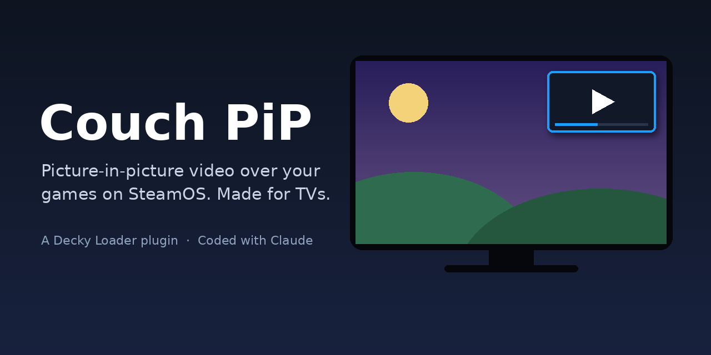

# Couch PiP



[](#coded-with-claude)
[](LICENSE)

Watch YouTube or other websites in a small window over your game in SteamOS
Game Mode, and control it with your controller. Made for
playing on a TV with a Steam Machine, and works on a Steam Deck too.

Couch PiP is a [Decky Loader](https://github.com/SteamDeckHomebrew/decky-loader)
plugin. It started as a fork of
[Picture in Picture](https://github.com/rossimo/decky-pip) by Ross Squires;
see [Credits](#credits).

## Features

- **Picture-in-picture over games.** The video stays on top of your game while
  the controller keeps working in the game.
- **Sized for TVs.** Works at 1080p, 1440p and 4K. Nine positions (corners,
  side middles, center), left/right and up/down sliders that reach every edge,
  and a size slider from 10% to 80%
  of the screen.
- **Controller remote.** Move a highlight around any website with the D-pad to
  sign in, search and pick videos. Type with the on-screen keyboard.
- **Trackpads.** In the remote, the right trackpad (or right stick) is a mouse,
  clicking it clicks, and the left trackpad scrolls. On the Steam Controller
  (2026) the trackpads are read directly from the controller.
- **Fills the window.** No scrollbars, and once a video has been playing for a
  few seconds the player fills the whole picture. The sites' own fullscreen
  buttons do the same.
- **Playback buttons** in the Quick Access Menu: back / ahead 10 seconds,
  play / pause, volume, fill window.
- **Saved sites.** YouTube is built in, and you can save any other site or
  home media server.
- **Dark mode and transparency.** Sites with a dark theme use it, or force
  dark on every site. A transparency slider lets your game show through.
- **Updates itself.** Checks this repository for new versions and installs
  them with one press through Decky's normal install prompt.

## Install

1. Install [Decky Loader](https://github.com/SteamDeckHomebrew/decky-loader).
2. If the original "Picture in Picture" plugin is installed, uninstall it first.
3. In Decky's settings, turn on **Developer mode**.
4. In the **Developer** tab, choose **Install plugin from URL** and enter:

   ```
   https://raw.githubusercontent.com/CaraJean206/couch-pip/main/couch-pip.zip
   ```

After that, new versions show up as a notification and an **Update** button
at the top of the plugin's panel. You can also press **Check for updates** at
the bottom.

## Please read: sign-ins and paid services

Couch PiP shows websites in Steam's built-in browser. That browser runs on
SteamOS, which is Linux, and many sites don't expect it. Before you rely on it:

**Signing in**

- You sign in on the websites themselves. Couch PiP never stores or logs your
  passwords. Text you type with the remote goes straight into the page.
- **"Continue with Google / Apple / Facebook" buttons** (third-party sign-in)
  often open a separate pop-up window. Steam's browser may not handle these in
  Game Mode, and there are reports of Steam crashing and restarting when one
  opens. **Sign in with an email and password instead whenever the site lets
  you.**
- Passkeys and USB security keys can't be used inside the picture (see
  [Known limits](#known-limits)).
- Use at your own risk. If a sign-in misbehaves, leave the picture, restart
  Steam if needed, and use the site on another device.

**Paid streaming services**

- Most paid services (for example Netflix, HBO Max, Paramount+, Philo, Disney+
  or Prime Video) use copy protection (DRM) and officially support only
  Windows, macOS and ChromeOS. On SteamOS they may refuse to play, show a
  browser error, or play at lower quality. Peacock blocks Linux outright.
- Couch PiP doesn't get around copy protection, region checks or paywalls, and
  isn't affiliated with any streaming service. Use them under their own terms.
- To find out whether Steam's browser can play protected video at all, use
  **Check video protection (DRM)** in [Diagnostics](#diagnostics).

## Using it

Open the Quick Access Menu (the `···` button), go to the Decky tab and choose
**Couch PiP**.

- **Choose what to watch / Change…** picks a site. Save another site or a home
  media server with **+ Add a site…**, for example `192.168.1.20:8096`.
- **Control page with controller** opens the remote.
- The **Picture** section sets position, size, edge spacing and fine tuning.

When you close the Quick Access Menu, the picture stays on top of your game
and the controller goes back to the game.

### Remote controls

| Button | Action |
| --- | --- |
| D-pad | Move the highlight |
| A | Click what's highlighted (text boxes open the keyboard) |
| B | Leave the remote |
| X | Play / pause |
| Y | Type text |
| L1 / R1 | Back / ahead 10 seconds |
| L2 / R2 | Volume down / up |
| View | Browser back |
| Menu | Fill window / full page |
| Right trackpad or right stick | Move the mouse cursor |
| Right trackpad click | Click under the cursor |
| Left trackpad | Scroll |

## Diagnostics

If something doesn't work, turn on **Show diagnostics** at the bottom of the
Couch PiP panel. A **Diagnostics** section appears with these tools. Results
only show on your screen; nothing is sent anywhere.

| Tool | What it does | Use it when |
| --- | --- | --- |
| **Screen / PiP bounds** (top lines) | Shows the screen size Steam reports and where the picture is placed. | The picture is the wrong size or in the wrong place. |
| **Use device pixels** | Switches how the picture's size is measured. | The picture is clearly too small, too big, or offset. |
| **List browser pages** | Lists the web pages Steam has open, marking the one the remote controls. | The remote says it can't connect to the page. |
| **Check video fill** | Shows the videos the plugin found and whether it filled the window. | A video doesn't fill the picture, or the picture goes blank. |
| **Snapshot page** | Shows a picture of what the browser itself is drawing. | The picture is black or white: if the snapshot looks right, the problem is Steam's display, not the page. |
| **Check video protection (DRM)** | Says whether Steam's browser can play copy-protected video (Widevine), which paid services need. | A paid streaming service won't play. |
| **Browser view functions** | Lists what Steam's browser view supports. | Helping investigate features like transparency. |
| **Steam input functions** | Lists the controller functions Steam offers plugins. | The trackpads don't respond. |
| **Controller devices** | Lists the controllers SteamOS sees and whether the plugin can read them. | The trackpads don't respond. |
| **Safe mode** | Turns off every change the plugin makes to web pages (scrollbar hiding, fill, cursor) and reloads the page. | A site behaves strangely, to check whether Couch PiP is the cause. |

With diagnostics on, the remote also shows a small live line of the controller
input it receives, which shows whether trackpad movement is arriving.

When reporting a problem, a photo of the relevant diagnostics result helps a
lot. Please [open an issue](https://github.com/CaraJean206/couch-pip/issues).

## Known limits

- It relies on undocumented parts of the Steam client, so a Steam update can
  break it.
- Passkeys and USB security keys can't be used to sign in to Google inside the
  picture, because their pop-up belongs to the browser and the remote can't
  reach it. Google offers your other sign-in methods instead (phone prompt,
  authenticator app or backup codes).
- It uses Steam's built-in browser. Other browsers such as Brave can't be used
  for the picture, because only Steam's own browser can be shown over a game
  this way.
- Paid streaming services may not play; see
  [sign-ins and paid services](#please-read-sign-ins-and-paid-services).
- Third-party sign-in pop-ups ("Continue with Google / Apple / Facebook") may
  crash Steam in Game Mode; sign in with an email and password instead.
- Direct trackpad reading supports the Steam Controller (2026). Other
  controllers use Steam's own input, which may not report trackpad movement on
  newer Steam builds.

## Security

Couch PiP runs as your normal user (no root), uses only Python's standard
library, never runs downloaded code, and only accepts updates from this
repository pinned to an exact commit with a checked fingerprint. The build is
reproducible and checked automatically. See [SECURITY.md](SECURITY.md) for
exactly what it accesses and how to verify it.

## Responsible use

Couch PiP is a browser window. It doesn't download videos, bypass DRM, block
ads or get around paywalls. Use streaming services under their own terms.

## How it works

- The picture is one of Steam's own built-in browser views, kept on screen
  above the game using the same layer Steam uses for notification pop-ups
  (`src/pip.tsx`).
- The remote controls that page through Steam's local DevTools port (the same
  one Decky uses), sending real clicks, key presses and typed text. A small
  helper script in the page hides scrollbars, fills the window and draws the
  trackpad cursor (`main.py`).
- On the Steam Controller (2026), the trackpads are read from the controller's
  HID reports while the remote is open, using the report layout documented in
  SDL (`main.py`, `PadReader`).
- No root access and no extra Python packages are needed.
- Couch PiP isn't in the Decky plugin store: the store doesn't accept
  AI-written code, and this plugin was written with Claude. It installs through
  Decky's developer mode instead.

More detail is in [How it was made](docs/how-it-was-made.md), and every
version is described in the [Changelog](CHANGELOG.md).

## Building

```sh
pnpm i            # or have esbuild and react-icons available
node build.mjs    # writes dist/index.js
python3 package.py
```

Release steps are at the top of `package.py`. It builds `couch-pip.zip` and
writes `version.json`, which the update check reads.

## Credits

- **[Picture in Picture](https://github.com/rossimo/decky-pip) by Ross
  Squires**, the original plugin this project is forked from. The core idea of
  showing a Steam browser view over a running game comes from it. Thank you!
- **[Decky Loader](https://github.com/SteamDeckHomebrew/decky-loader) and the
  [plugin template](https://github.com/SteamDeckHomebrew/decky-plugin-template)**
  by Steam Deck Homebrew.
- **[SDL](https://github.com/libsdl-org/SDL)**, whose Steam Controller driver
  documents the trackpad report format.
- **[react-icons](https://github.com/react-icons/react-icons)** and
  **[Font Awesome Free](https://fontawesome.com/)** icons (CC BY 4.0).

Full notices are in [THIRD_PARTY_NOTICES.md](THIRD_PARTY_NOTICES.md).

## Coded with Claude

This plugin was coded with [Claude](https://claude.ai), Anthropic's AI
assistant. The project owner described what they wanted, tested every version
on a real Steam Machine and reported back what happened. Claude wrote the
code, the tests and this documentation. Commits made by Claude are marked
with a `Co-Authored-By: Claude` line.

## License

BSD 3-Clause License, the same license as the original project. See
[LICENSE](LICENSE), which keeps the original copyright notices.

Steam, Steam Deck, Steam Machine and Steam Controller are trademarks of Valve
Corporation. Other product names are trademarks of their owners. Couch PiP is
not affiliated with or endorsed by Valve or any streaming service.
