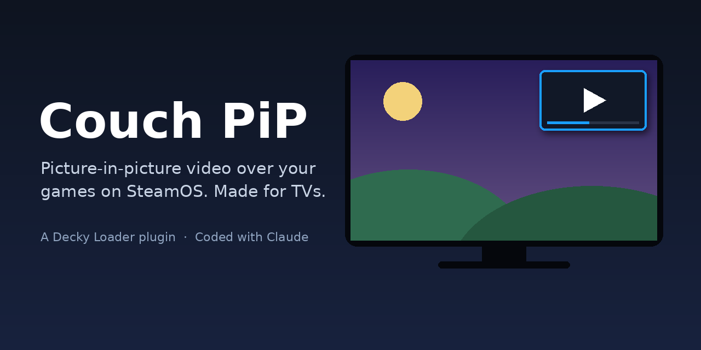

# Couch PiP



[](#coded-with-claude)
[](LICENSE)

Watch YouTube, Twitch, Plex, Jellyfin or any website in a small window over
your game in SteamOS Game Mode, and control it with your controller. Made for
playing on a TV with a Steam Machine, and works on a Steam Deck too.

Couch PiP is a [Decky Loader](https://github.com/SteamDeckHomebrew/decky-loader)
plugin. It started as a fork of
[Picture in Picture](https://github.com/rossimo/decky-pip) by Ross Squires;
see [Credits](#credits).

## Features

- **Picture-in-picture over games.** The video stays on top of your game while
  the controller keeps working in the game.
- **Sized for TVs.** Works at 1080p, 1440p and 4K. Nine positions (corners,
  side middles, center), fine-tune sliders, and a size slider from 10% to 80%
  of the screen.
- **Controller remote.** Move a highlight around any website with the D-pad to
  sign in, search and pick videos. Type with the on-screen keyboard.
- **Trackpads.** In the remote, the right trackpad (or right stick) is a mouse,
  clicking it clicks, and the left trackpad scrolls. On the Steam Controller
  (2026) the trackpads are read directly from the controller.
- **Fills the window.** No scrollbars, and once a video has been playing for a
  few seconds the player fills the whole picture. The sites' own fullscreen
  buttons do the same.
- **Playback buttons** in the Quick Access Menu: back / ahead 10 seconds,
  play / pause, volume, fill window.
- **Saved sources.** Shortcuts for common sites plus your own bookmarks, such
  as a home Jellyfin or Plex server.
- **Updates itself.** Checks this repository for new versions and installs
  them with one press through Decky's normal install prompt.

## Install

1. Install [Decky Loader](https://github.com/SteamDeckHomebrew/decky-loader).
2. If the original "Picture in Picture" plugin is installed, uninstall it first.
3. In Decky's settings, turn on **Developer mode**.
4. In the **Developer** tab, choose **Install plugin from URL** and enter:

   ```
   https://raw.githubusercontent.com/CaraJean206/couch-pip/main/couch-pip.zip
   ```

After that, new versions show up as a notification and an **Update** button
at the top of the plugin's panel. You can also press **Check for updates** at
the bottom.

## Using it

Open the Quick Access Menu (the `···` button), go to the Decky tab and choose
**Couch PiP**.

- **Choose what to watch / Change…** picks a site. Add a home server with
  **+ Add Jellyfin, Plex server or any site…**, for example `192.168.1.20:8096`.
- **Control page with controller** opens the remote.
- The **Picture** section sets position, size, edge spacing and fine tuning.

When you close the Quick Access Menu, the picture stays on top of your game
and the controller goes back to the game.

### Remote controls

| Button | Action |
| --- | --- |
| D-pad | Move the highlight |
| A | Click what's highlighted (text boxes open the keyboard) |
| B | Leave the remote |
| X | Play / pause |
| Y | Type text |
| L1 / R1 | Back / ahead 10 seconds |
| L2 / R2 | Volume down / up |
| View | Browser back |
| Menu | Fill window / full page |
| Right trackpad or right stick | Move the mouse cursor |
| Right trackpad click | Click under the cursor |
| Left trackpad | Scroll |

## Troubleshooting

Turn on **Show diagnostics** at the bottom of the panel for these tools:

- **Use device pixels**: try this if the picture is the wrong size or in the
  wrong place.
- **Check video fill** and **Snapshot page**: show what the plugin and the
  browser see when a video doesn't display properly.
- **Safe mode**: turns off every change the plugin makes to web pages.
- **Steam input functions** and **Controller devices**: help find out why the
  trackpads don't respond.
- With diagnostics on, the remote also shows a small live line of the
  controller input it receives.

## Known limits

- It relies on undocumented parts of the Steam client, so a Steam update can
  break it.
- Netflix, Disney+ and Prime Video need DRM support in Steam's built-in browser.
  They may not play, or may play at lower quality.
- Direct trackpad reading supports the Steam Controller (2026). Other
  controllers use Steam's own input, which may not report trackpad movement on
  newer Steam builds.

## Responsible use

Couch PiP is a browser window. It doesn't download videos, bypass DRM, block
ads or get around paywalls. Use streaming services under their own terms.

## How it works

- The picture is one of Steam's own built-in browser views, kept on screen
  above the game using the same layer Steam uses for notification pop-ups
  (`src/pip.tsx`).
- The remote controls that page through Steam's local DevTools port (the same
  one Decky uses), sending real clicks, key presses and typed text. A small
  helper script in the page hides scrollbars, fills the window and draws the
  trackpad cursor (`main.py`).
- On the Steam Controller (2026), the trackpads are read from the controller's
  HID reports while the remote is open, using the report layout documented in
  SDL (`main.py`, `PadReader`).
- No root access and no extra Python packages are needed.

More detail is in [How it was made](docs/how-it-was-made.md), and every
version is described in the [Changelog](CHANGELOG.md).

## Building

```sh
pnpm i            # or have esbuild and react-icons available
node build.mjs    # writes dist/index.js
python3 package.py
```

Release steps are at the top of `package.py`. It builds `couch-pip.zip` and
writes `version.json`, which the update check reads.

## Credits

- **[Picture in Picture](https://github.com/rossimo/decky-pip) by Ross
  Squires**, the original plugin this project is forked from. The core idea of
  showing a Steam browser view over a running game comes from it. Thank you!
- **[Decky Loader](https://github.com/SteamDeckHomebrew/decky-loader) and the
  [plugin template](https://github.com/SteamDeckHomebrew/decky-plugin-template)**
  by Steam Deck Homebrew.
- **[SDL](https://github.com/libsdl-org/SDL)**, whose Steam Controller driver
  documents the trackpad report format.
- **[react-icons](https://github.com/react-icons/react-icons)** and
  **[Font Awesome Free](https://fontawesome.com/)** icons (CC BY 4.0).

Full notices are in [THIRD_PARTY_NOTICES.md](THIRD_PARTY_NOTICES.md).

## Coded with Claude

This plugin was coded with [Claude](https://claude.ai), Anthropic's AI
assistant. The project owner described what they wanted, tested every version
on a real Steam Machine and reported back what happened. Claude wrote the
code, the tests and this documentation. Commits made by Claude are marked
with a `Co-Authored-By: Claude` line.

## License

BSD 3-Clause License, the same license as the original project. See
[LICENSE](LICENSE), which keeps the original copyright notices.

Steam, Steam Deck, Steam Machine and Steam Controller are trademarks of Valve
Corporation. Other product names are trademarks of their owners. Couch PiP is
not affiliated with or endorsed by Valve or any streaming service.
